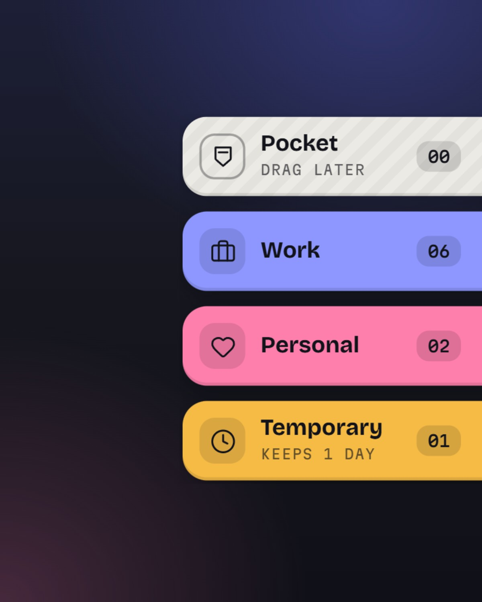
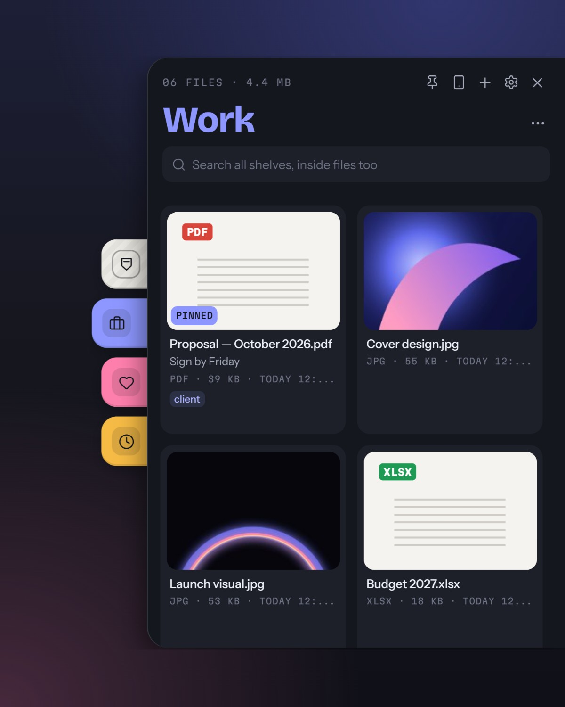
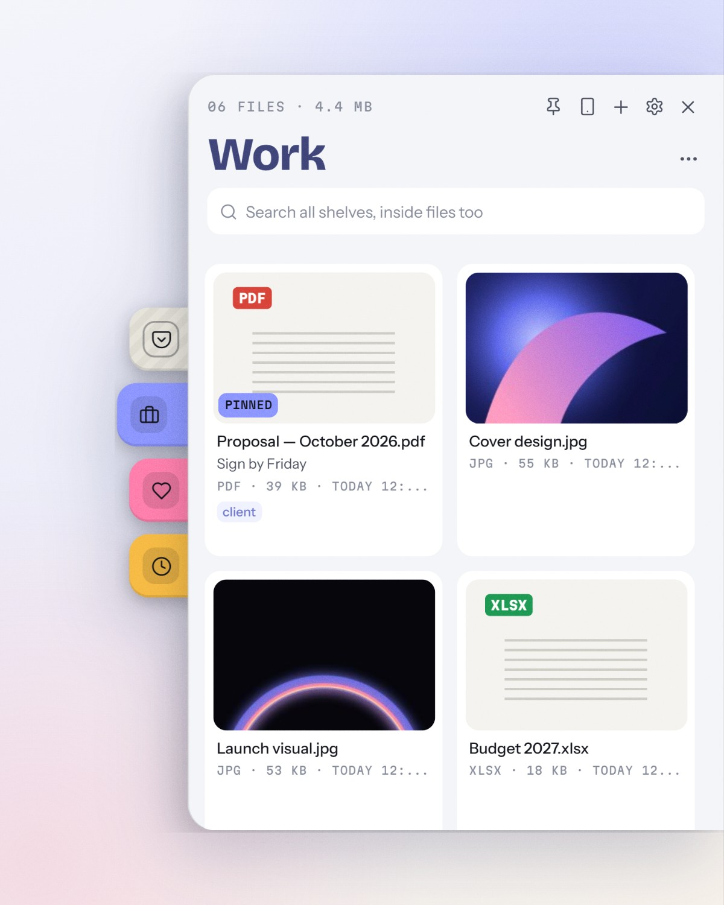
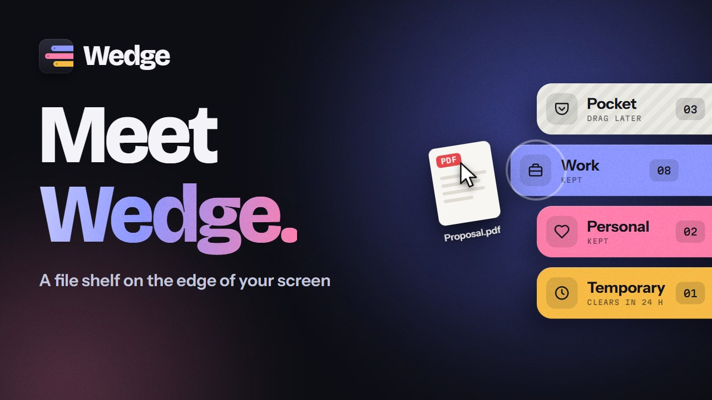
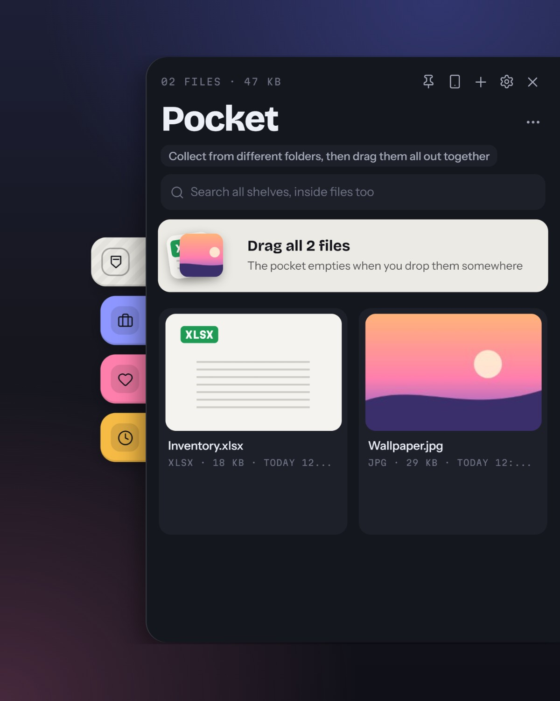
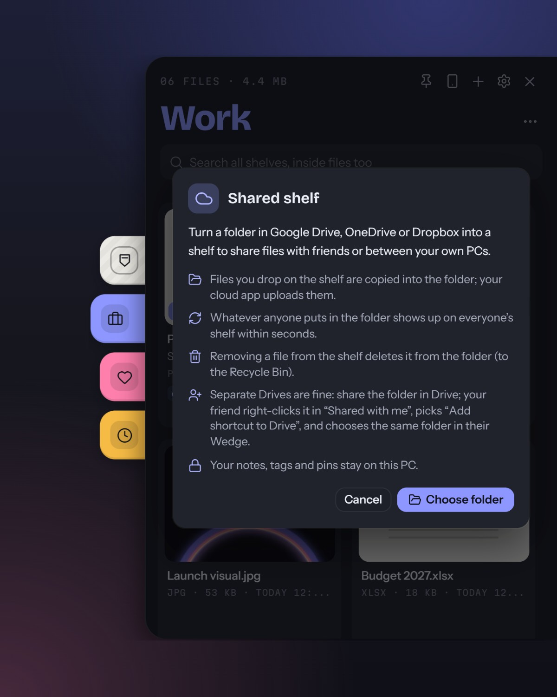
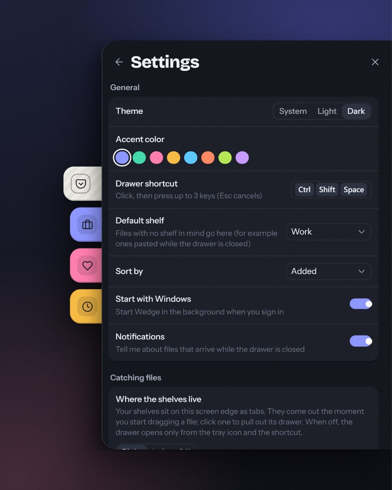

<p align="center">
  
</p>

<h1 align="center">Wedge</h1>

<p align="center">
  <strong>A file shelf on the edge of your screen</strong><br>
  Wedge files into the side of your screen while you work, and drag them out when you need them.
</p>

<p align="center">
  <a href="https://wedge.regncreative.com"><strong>wedge.regncreative.com</strong></a>
</p>

<p align="center">
  <a href="https://wedge.regncreative.com"></a>
  <a href="https://github.com/Regncreative/Wedge/actions/workflows/ci.yml"></a>
  <a href="https://github.com/Regncreative/Wedge/actions/workflows/codeql.yml"></a>
  <a href="https://github.com/Regncreative/Wedge/releases/latest"></a>
  
  
  
  <a href="LICENSE"></a>
</p>

<p align="center">
  
  &nbsp;
  
  &nbsp;
  
</p>

<p align="center">
  <a href="https://wedge.regncreative.com/#film"></a>
  <br>
  <sub><a href="https://wedge.regncreative.com/#film">▶ Watch the 56-second film</a></sub>
</p>

> **Wedge was called Stash.** Same app, new name and logo with 2.0. Stash 1.x updates to Wedge by itself and keeps every shelf and setting.

## What is Wedge?

Windows has no good place to park files while you work, so they pile up on the desktop or get lost in Downloads.

**Wedge** keeps your shelves on the edge of the screen. Start dragging a file anywhere and colored shelf tabs slide out; drop it on one. Click a tab and that shelf opens like a drawer, ready to drag files back into any app. Wedge only remembers where your files are: they stay where they are on disk.

It is small and quiet: a 5 MB installer, the WebView2 engine that comes with Windows, and no CPU use while it waits at the edge.

## Features

**Collect from anywhere**

- **Shelves on the screen edge**: tucked-in tabs slide out the moment you start dragging a file from File Explorer, the desktop or a browser; drop on the shelf you want
- **Drawers**: click a tab to pull its shelf out; drag a card onto another tab to move it
- **Pocket**: collect files from different folders, then drag them all out in one go (the pocket empties itself)
- **Automatic shelves**: new downloads and screenshots land on their own shelves; rules send files to the right shelf by type
- **Right-click → Add to Wedge** in File Explorer (on Windows 11 under _Show more options_), **Ctrl+V** for files, images, links and text, and **from your phone** by scanning a QR code

**Share**

- **Shared shelves**: turn a Google Drive, OneDrive or Dropbox folder into a shelf. Files you drop are copied into the folder; whatever a friend (or your other PC) puts there shows up on your shelf

**Find and use**

- **Real previews**: every card shows the file as File Explorer would; Space opens Quick Look; desktop widgets preview on hover
- **Search inside files**: PDF, Word, Excel, PowerPoint, OpenDocument, text and code, across every shelf
- **Quick actions**: ZIP, convert images (JPG, PNG, WebP), **reduce size** (never makes a file bigger), copy into a folder, open all, drag a whole shelf out as one ZIP
- **Notes, tags and reminders** on any file; **temporary shelves** that clear themselves after 24 hours, 7 or 30 days
- **Desktop widgets**: pin a shelf to the desktop

**Plus**

- **Its own look**: colored index tabs, cards with real previews, dark and light themes, a color and an icon per shelf
- **Multi-select**: Ctrl/Shift+click, then drag, pin or remove several files at once
- **Keyboard friendly**: move, open, pin and remove without the mouse ([shortcuts](docs/FAQ.md#keyboard-shortcuts))
- **Global shortcut**: open the drawer with `Ctrl+Shift+Space` (customizable)
- **Steps aside** while a game, a video or a presentation runs full screen
- **Turkish and English**
- **Signed updates** from GitHub Releases, with an opt-in beta channel
- **Export / import**: move your shelves and settings to another PC
- **Missing-file awareness**: deleted or moved files show as unavailable until you clear them
- **Private**: no account, no telemetry ([privacy](PRIVACY.md))

## Screenshots

<p align="center">
  
  &nbsp;
  
  &nbsp;
  
</p>

## Installation

1. Download from **[wedge.regncreative.com](https://wedge.regncreative.com)** or the **[latest release](https://github.com/Regncreative/Wedge/releases/latest)** (`Wedge_<version>_x64-setup.exe`)
2. Run the installer; no administrator rights needed
3. On first start, choose whether Wedge starts with Windows and adds **Add to Wedge** to File Explorer's right-click menu (you can change both later in Settings)
4. Start dragging a file: your shelves slide out of the right edge of the screen. Or click a tab, the tray icon, or press `Ctrl+Shift+Space`

Coming from Stash? Installing Wedge replaces Stash 1.x, and your shelves and settings move from `%APPDATA%\Stash` to `%APPDATA%\Wedge` on the first start.

A Microsoft Store release is being prepared ([checklist](docs/microsoft-store.md)).

## For developers

Requires Windows 10/11, [Node.js 22](https://nodejs.org) (`.nvmrc`), [Rust](https://rustup.rs) and the Visual Studio C++ Build Tools ([Tauri prerequisites](https://v2.tauri.app/start/prerequisites/)).

```bash
npm ci
npm run dev
```

| Command                                     | What it does                                                                                 |
| ------------------------------------------- | -------------------------------------------------------------------------------------------- |
| `npm run dev`                               | Run the app with hot reload                                                                  |
| `npm run build`                             | Release build and installer (`src-tauri/target/release/bundle/nsis/`)                        |
| `npm run build:msix`                        | Microsoft Store package (MSIX); see [docs/microsoft-store.md](docs/microsoft-store.md)       |
| `npm test`                                  | Frontend unit tests (Vitest)                                                                 |
| `npm run test:rust`                         | Backend unit tests (cargo test)                                                              |
| `npm run build:e2e` then `npm run test:e2e` | End-to-end tests against the real app (Playwright over WebView2)                             |
| `npm run test:perf`                         | Performance numbers: start-up, idle cost, edge latency, animation frames, a 1,000-file shelf |
| `npm run icons`                             | Make every app icon from `assets/brand/*.svg`                                                |
| `npm run typecheck`                         | TypeScript check                                                                             |
| `npm run lint`                              | ESLint and Clippy                                                                            |

See [CONTRIBUTING.md](CONTRIBUTING.md) for tests and conventions.

### Tech stack

- **Tauri 2** with a **Rust** backend; UI in **React**, **TypeScript** and **Vite**
- **Tailwind CSS**, **Framer Motion**, **Zustand**
- **rusqlite** (SQLite), the **windows** crate for shell icons, drag detection and the edge window, **drag** for native drag-out
- Tauri plugins for tray, global shortcut, autostart, notifications, dialogs, logging and signed updates
- **Vitest**, **cargo test** and **Playwright** for tests; GitHub Actions on Windows for CI and releases

### Architecture

```text
┌─────────────────────────────────────────┐
│                 Windows                 │
│  Tray · Global hotkey · Shell / files   │
└───────────────────┬─────────────────────┘
                    │
┌───────────────────▼─────────────────────┐
│           Rust backend (Tauri)          │
│  Edge window · Drag watch · Widgets     │
│  SQLite (rusqlite) · validated commands │
└───────────────────┬─────────────────────┘
                    │ invoke / events
┌───────────────────▼─────────────────────┐
│     React tabs and drawer (WebView2)    │
│  window.stash API · shelves · settings  │
└─────────────────────────────────────────┘
```

Inside the code the app still goes by its old name in places (`window.stash`, `useStashStore`, `STASH_*` variables); only what people see was renamed.

### Project structure

```text
assets/brand/     Logo and tray glyph (SVG sources for every icon)
src/
  renderer/       React UI (edge tabs, drawer, widgets); lib/api.ts bridges to Rust
  shared/         Types and translations (locales/)
src-tauri/
  src/            Rust backend: commands, database, edge window, drag watch, shared shelves, updater
  windows/        Installer hooks (upgrade from Stash 1.x, clean uninstall)
  tauri.conf.json App, window, bundle and updater configuration
tests/
  unit/           Vitest
  e2e/            Playwright, driving the real wedge.exe
scripts/          Release and icon helpers
```

## Roadmap

- [x] Shelves, drag and drop, global shortcut, themes, Turkish and English
- [x] Signed auto-updates with staged rollouts and a beta channel
- [x] 2.0: rebuilt on Tauri (5 MB installer)
- [x] Automatic shelves, rules, content search, Quick Look
- [x] Phone to PC, desktop widgets, quick actions
- [x] Shelves on the screen edge, pocket, shared shelves (cloud folders), new design
- [x] New name and logo: Wedge
- [ ] Next version: choose which display (and edge) the shelves live on, for multi-monitor setups
- [ ] Quick notes: a shelf you type into directly, docked to the edge like the others
- [ ] Code signing
- [ ] Microsoft Store and winget
- [ ] Share links
- [ ] Smarter search

## Releases and updates

Installed copies check [GitHub Releases](https://github.com/Regncreative/Wedge/releases) for updates on launch and from the tray or Settings. Users can opt into beta versions in Settings.

Releases are built by GitHub Actions, not on a developer machine: push a version tag and the **Release** workflow tests, builds and uploads the installer to a draft release for review. Rollouts can be staged with the **Rollout** workflow. See [CONTRIBUTING.md](CONTRIBUTING.md#releasing-maintainers).

## Contributing

Issues and pull requests are welcome. See [CONTRIBUTING.md](CONTRIBUTING.md) for setup, checks and conventions, and [SECURITY.md](SECURITY.md) to report a vulnerability privately.

## License

[MIT](LICENSE) © Regncreative
