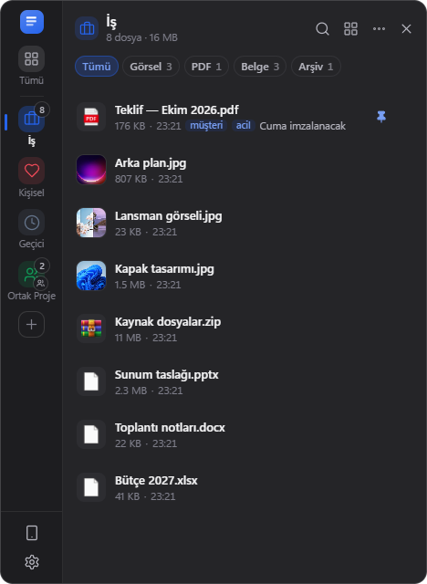
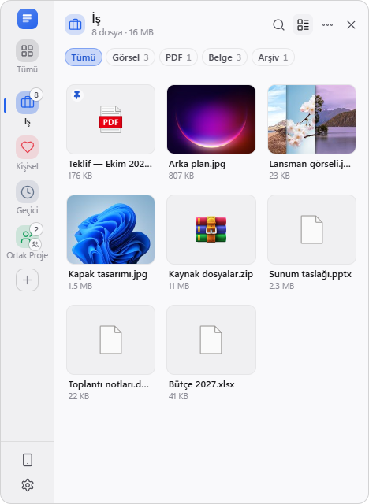
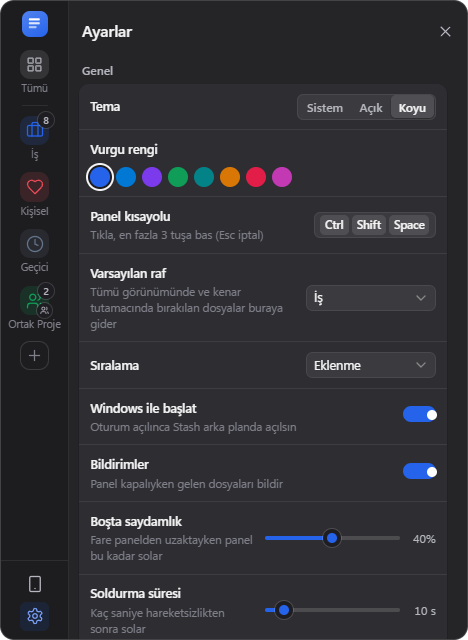
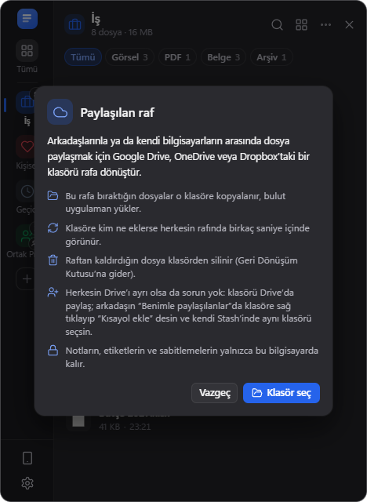

<p align="center">
  
</p>

<h1 align="center">Stash</h1>

<p align="center">
  <strong>A modern file shelf for Windows</strong><br>
  Keep files within reach — without cluttering your desktop.
</p>

<p align="center">
  <a href="https://stash.regncreative.com"><strong>stash.regncreative.com</strong></a>
</p>

<p align="center">
  <a href="https://stash.regncreative.com"></a>
  <a href="https://github.com/Regncreative/Stash/actions/workflows/ci.yml"></a>
  <a href="https://github.com/Regncreative/Stash/actions/workflows/codeql.yml"></a>
  <a href="https://github.com/Regncreative/Stash/releases/latest"></a>
  
  
  
  
  <a href="LICENSE"></a>
</p>

<p align="center">
  
  &nbsp;
  
</p>

## What is Stash?

Windows doesn’t have a convenient place to park files while you work — so people pile them on the desktop, spam Downloads, or lose track mid-flow.

**Stash** adds a lightweight file shelf that lives in the system tray. Drop files onto shelves, pin what matters, then drag them back into any app when you need them. Stash stores **references only** — your files stay where they are on disk.

Designed to feel like a built-in Windows 11 feature (Fluent Design), and light like one: a **3 MB installer** that uses the WebView2 runtime built into Windows.

## Features

**Collect from anywhere**
- **Edge handle** — a slim tab on the side of the screen: drag files onto it and pick a shelf, even while the panel is closed; click it to open the panel
- **Drop onto any shelf** — drop on the panel, or straight onto a shelf in the rail; drag a file onto another shelf to move it
- **Automatic shelves** — new downloads and screenshots appear on their own shelves; rules send files to the right shelf by type
- **Right-click → Add to Stash** in Explorer, **Ctrl+V** for files, images, links and text, and **from your phone** by scanning a QR code

**Share**
- **Shared shelves** — turn a Google Drive, OneDrive or Dropbox folder into a shelf. Files you drop are copied into the folder; whatever a friend (or your other PC) puts there shows up on your shelf. Everyone keeps their own Drive and just links the same shared folder

**Find and use**
- **Previews everywhere** — thumbnails in the list, a grid view, Space for Quick Look, and previews in desktop widgets
- **Search inside files** — PDF, Word, Excel, PowerPoint, text and code, across every shelf
- **Quick actions** — ZIP, convert images (JPG, PNG, lossy WebP), **reduce size** (never makes a file bigger), copy into a folder, open all, drag a whole shelf as one ZIP
- **Notes, tags and reminders** on any file; **temporary shelves** that clean themselves up
- **Desktop widgets** — pin a shelf to the desktop

**Plus**
- **New design** — a shelf rail on the left, content on the right; Fluent-style dark and light themes with accent colors
- **System tray integration** — silent background app, always one click away
- **Multi-select** — Ctrl/Shift+click, then drag, pin or remove several files at once
- **Keyboard friendly** — navigate, open, pin and remove without the mouse ([shortcuts](docs/FAQ.md#keyboard-shortcuts))
- **Global shortcut** — open the panel with `Ctrl+Shift+Space` (customizable)
- **Turkish & English** — full UI + tray localization
- **Auto update** — updates from GitHub Releases, with an opt-in beta channel; every update is signature-checked
- **Export / import** — move your shelves and settings to another PC
- **Small and light** — 3 MB installer, low memory use, browser engine kept up to date by Windows
- **Missing-file awareness** — deleted or moved files show as unavailable until you clear them
- **Private by design** — no account, no telemetry ([privacy](PRIVACY.md))

## Screenshots

<p align="center">
  
  &nbsp;
  
</p>

## Installation

### For everyone (recommended)

1. Download from **[stash.regncreative.com](https://stash.regncreative.com)** or the **[latest release](https://github.com/Regncreative/Stash/releases/latest)** (`Stash_<version>_x64-setup.exe`)
2. Run the installer
3. Launch **Stash** — it appears in the system tray
4. Click the tray icon (or press `Ctrl+Shift+Space`) to open the panel

> Tip: enable **Start with Windows** in Settings so Stash is ready after sign-in.
>
> Upgrading from 1.x happens automatically: the 2.0 installer replaces the old app and keeps all your shelves and settings.

### For developers

Requires Windows 10/11, [Node.js 22](https://nodejs.org) (`.nvmrc`), [Rust](https://rustup.rs) and the Visual Studio C++ Build Tools ([Tauri prerequisites](https://v2.tauri.app/start/prerequisites/)).

```bash
npm ci
npm run dev
```

The app starts silently in the tray. Click the tray icon or use the hotkey to open the panel. See [CONTRIBUTING.md](CONTRIBUTING.md) for tests and conventions.

## Development

| Command | Description |
|---------|-------------|
| `npm run dev` | Run the app with hot reload |
| `npm run build` | Release build + installer (`src-tauri/target/release/bundle/nsis/`) |
| `npm test` | Frontend unit tests (Vitest) |
| `npm run test:rust` | Backend unit tests (cargo test) |
| `npm run build:e2e` then `npm run test:e2e` | End-to-end tests against the real app (Playwright over WebView2) |
| `npm run typecheck` | TypeScript check |
| `npm run lint` | ESLint + Clippy |

## Tech stack

- **Tauri 2** with a **Rust** backend; UI in **React** + **TypeScript** + **Vite**
- **Tailwind CSS** + **Framer Motion** + **Zustand**
- **rusqlite** (SQLite), the **windows** crate for shell icons and Properties, **drag** for native drag-out
- Tauri plugins for tray, global shortcut, autostart, notifications, dialogs, logging and signed updates
- **Vitest**, **cargo test** + **Playwright** for tests, GitHub Actions on Windows for CI and releases

## Architecture

```text
┌─────────────────────────────────────────┐
│                 Windows                 │
│  Tray · Global hotkey · Shell / files   │
└───────────────────┬─────────────────────┘
                    │
┌───────────────────▼─────────────────────┐
│           Rust backend (Tauri)          │
│  Panel · Edge handle · Widgets · Tray   │
│  SQLite (rusqlite) · validated commands │
└───────────────────┬─────────────────────┘
                    │ invoke / events
┌───────────────────▼─────────────────────┐
│        React panel (WebView2)           │
│  window.stash API · shelves · settings  │
└─────────────────────────────────────────┘
```

## Project structure

```text
src/
  renderer/       React UI (panel, edge handle, widgets); lib/api.ts bridges to Rust
  shared/         Types and translations (locales/)
src-tauri/
  src/            Rust backend: commands, database, shared shelves, edge handle, tray, updater
  windows/        Installer hooks (upgrade from 1.x)
  tauri.conf.json App, window, bundle and updater configuration
tests/
  unit/           Vitest
  e2e/            Playwright, driving the real stash.exe
scripts/          Release helpers
```

## Roadmap

- [x] System tray panel
- [x] Shelves & drag-and-drop
- [x] Global shortcut
- [x] Themes, accents, localization (TR/EN)
- [x] Auto update via GitHub Releases
- [x] Idle opacity & missing-file cleanup
- [x] Multi-select, keyboard navigation, export / import
- [x] Automated, staged releases with a beta channel
- [x] 2.0: rebuilt on Tauri (3 MB installer, signed updates)
- [x] Automatic shelves, rules, content search, Quick Look
- [x] Phone to PC, desktop widgets, quick actions
- [x] Edge handle, shared shelves (cloud folders), new design
- [ ] Share links (needs a hosting decision)
- [ ] New demo GIF
- [ ] Code signing
- [ ] Microsoft Store and winget
- [ ] Plugins / extensions
- [ ] Smarter / AI-assisted search

## Releases & auto-update

Installed copies check [GitHub Releases](https://github.com/Regncreative/Stash/releases) for updates on launch and from the tray / Settings. Users can opt into beta versions in Settings.

Releases are built by GitHub Actions, not on a developer machine: push a version tag and the **Release** workflow tests, builds and uploads the installer to a draft release for review. Rollouts can be staged with the **Rollout** workflow. See [CONTRIBUTING.md](CONTRIBUTING.md#releasing-maintainers).

## Contributing

Issues and pull requests are welcome. See [CONTRIBUTING.md](CONTRIBUTING.md) for setup, checks and conventions, and [SECURITY.md](SECURITY.md) to report a vulnerability privately.

## License

[MIT](LICENSE) © Regncreative
